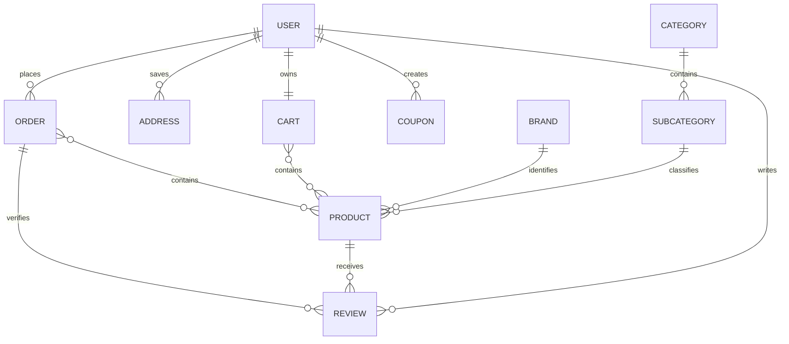

# E-Commerce REST API

A modular REST API for an e-commerce platform, built with Node.js, Express, and MongoDB. The project covers account authentication, product variants, categories, brands, carts, coupons, orders, reviews, image uploads, and customer delivery addresses.

> This project is under active development and is not yet production-ready. See [Current limitations](#current-limitations) before deploying it.

## Features

- Separate customer and seller registration routes (shared signup refactor in progress), email confirmation, login, and password recovery
- JWT-based authentication and role checks for seller management and customer orders
- Category, subcategory, and brand management
- Products with multiple variants, options, stock, discounts, and images
- Public product catalog with search, filtering, sorting, pagination, and optional result counts
- Public brand listing and related-brand lookup by subcategory
- Cloudinary image storage
- Shopping cart management
- Percentage and fixed-value coupons
- Order creation from a cart or a supplied product list
- Stripe Checkout sessions for card payments and an order webhook (integration in progress)
- Verified-purchase product reviews and aggregate ratings
- User-owned delivery addresses with default-address handling
- Request validation with Joi
- Automated tests using Node.js's built-in test runner

## Tech stack

- **Runtime:** Node.js with ES modules
- **Framework:** Express 5
- **Database:** MongoDB with Mongoose
- **Authentication:** JSON Web Tokens and bcryptjs
- **Validation:** Joi
- **File uploads:** Multer and Cloudinary
- **Email:** Nodemailer with Gmail
- **Payments:** Stripe Checkout
- **Testing:** `node:test` and `node:assert`

## Project structure

```text
.
|-- config/                 # Local environment variables (not committed)
|-- DB/
|   |-- Models/             # Mongoose models
|   `-- connection.js       # MongoDB connection
|-- Src/
|   |-- Middelware/         # Authentication and shared validation
|   |-- Modules/            # Feature routes, controllers, and validation
|   |   |-- Address/
|   |   |-- Auth/
|   |   |-- Brand/
|   |   |-- Cart/
|   |   |-- Category/
|   |   |-- Coupon/
|   |   |-- Order/
|   |   |-- Product/
|   |   |-- Review/
|   |   |-- SubCategory/
|   |   `-- User/
|   |-- Utills/             # JWT, hashing, email, uploads, and errors
|   `-- index.route.js      # Main route registration
|-- tests/                  # Node.js tests
|-- .env.example
|-- index.js                # Application entry point
`-- package.json
```

## Getting started

### Prerequisites

- Node.js 24.x (also used on Vercel)
- MongoDB, either local or hosted
- A Cloudinary account for image uploads
- A Gmail account with an app password for email delivery

## Environment variables

| Variable | Purpose |
| --- | --- |
| `DB_ATLAS` | MongoDB connection string; use a hosted database on Vercel |
| `SALT_ROUND` | bcrypt hashing rounds |
| `TOKEN_SIGNATURE` | Secret used to sign and verify JWTs |
| `expireTime` | JWT lifetime passed to `jsonwebtoken`, in seconds |
| `refreshExpireTime` | Resend-confirmation token lifetime in seconds; falls back to `expireTime` when unset |
| `BEARER_KEY` | Authorization prefix, usually `Bearer ` including the space |
| `MOOD` | Application environment label |
| `App` | Cloudinary folder name used by category and subcategory uploads |
| `APP` | Cloudinary folder name used by product uploads |
| `gmail` | Gmail sender address |
| `gmailPass` | Gmail app password |
| `cloud_name` | Cloudinary cloud name |
| `api_key` | Cloudinary API key |
| `api_secret` | Cloudinary API secret |
| `PORT` | Local HTTP port; defaults to `3000` |
| `STRIPE_SECRET_KEY` | Stripe API secret for card checkout and webhook handling |
| `STRIPE_SUCCESS_URL` | Redirect URL after successful Stripe Checkout |
| `STRIPE_CANCEL_URL` | Checkout cancellation redirect URL; the controller appends `orderId` |
| `endpointSecret` | Stripe webhook signing secret; required for signature verification and event parsing in the current handler |


Never commit `config/.env`. It is already excluded by `.gitignore`.

## Authentication

Protected endpoints expect the JWT returned by `POST /auth/login`:

```http
Authorization: Bearer <token>
```

The exact prefix is configured through `BEARER_KEY`.

### Example registration

```bash
curl -X POST http://localhost:3000/auth/signup \
  -H "Content-Type: application/json" \
  -d '{
    "name": "Jane Doe",
    "email": "jane@example.com",
    "phone": "01000000000",
    "password": "strong-password",
    "cPassword": "strong-password"
  }'
```

For seller registration, send the same body to `POST /auth/seller/signup`. The routes assign `User` and `Seller` respectively; do not supply a role in the request body.

The intended flow creates an account, then emails a confirmation link that must be followed before login.

### Example login

```bash
curl -X POST http://localhost:3000/auth/login \
  -H "Content-Type: application/json" \
  -d '{
    "email": "jane@example.com",
    "password": "strong-password"
  }'
```

## API reference

Routes marked **Seller**, **User**, or **Blocked** require the `Authorization` header. **Blocked** indicates that an empty role allowlist currently prevents access. File-upload routes use `multipart/form-data`; other request bodies use JSON.

### Authentication

| Method | Endpoint | Access | Description |
| --- | --- | --- | --- |
| `POST` | `/auth/signup` | Public | Register a customer (`User`); shared helper currently incomplete |
| `POST` | `/auth/seller/signup` | Public | Register a seller (`Seller`); shared helper currently incomplete |
| `POST` | `/auth/login` | Public | Log in a confirmed user and return a JWT |
| `GET` | `/auth/emailConfirmation/:token` | Public | Confirm an email address |
| `GET` | `/auth/newconfirmationemail/:token` | Public | Send another confirmation email |
| `PATCH` | `/auth/passcode` | Public | Send a password-reset OTP |
| `PATCH` | `/auth/resetcode` | Public | Reset a password using an OTP |
| `PATCH` | `/auth/forgetlink` | Public | Send a password-reset link |
| `PATCH` | `/auth/resetlink/:token` | Public | Reset a password using a token; emailed URL still needs alignment |

### Categories and subcategories

| Method | Endpoint | Access | Description |
| --- | --- | --- | --- |
| `GET` | `/category` | Public | List categories with their subcategories |
| `POST` | `/category` | Seller | Create a category with an `image` file |
| `PATCH` | `/category/:categoryId` | Seller | Update a category and optionally replace its image |
| `GET` | `/category/:categoryId/subcategory` | Public | List subcategories in a category |
| `POST` | `/category/:categoryId/subcategory` | Seller | Create a subcategory with an `image` file |
| `PATCH` | `/category/:categoryId/subcategory/:subCategoryId` | Seller | Update a subcategory |

### Brands

| Method | Endpoint | Access | Description |
| --- | --- | --- | --- |
| `GET` | `/brand` | Public | List brand names, images, and slugs alphabetically |
| `POST` | `/brand` | Seller | Create a brand with an `image` file |
| `PATCH` | `/brand/:brandId` | Seller | Update a brand and optionally replace its image |

### Products and variants

| Method | Endpoint | Access | Description |
| --- | --- | --- | --- |
| `GET` | `/product` | Public | Browse, search, and filter available product variants |
| `POST` | `/product` | Seller | Create a product and its first variant |
| `PUT` | `/product/:productId` | Seller | Update product-level information |
| `POST` | `/product/:productId/variant` | Seller | Add a variant to a product |
| `GET` | `/product/:productId/variant/:variantId` | Public | Get one product variant |
| `PATCH` | `/product/:productId/variant/:variantId` | Seller | Update a variant |
| `DELETE` | `/product/:productId/variant/:variantId` | Seller | Delete a variant |
| `GET` | `/product/:subCategoryId/brand` | Public | Get distinct brand names associated with a subcategory |

Product creation uses `multipart/form-data` with the following fields:

- Required text fields: `name`, `description`, `price`, `categoryId`, `subCategoryId`, and `brandId`
- Required file field: `mainImage` (one file)
- Optional file field: `subImages` (up to four files)
- Optional fields: `stock`, `discount`, `options`, and `specifications`
- `options` and `specifications` must be JSON-encoded strings when sent as form fields

Names belong to variants: responses contain `variants[].name` and no product-level `name`. The flat `name` form field on `POST /product` names the first variant. `POST /product/:productId/variant` requires its own `name` and `price`; provide either uploaded images or `imageSourceVariantId` to reuse images from the same product. Rename a variant with `PATCH /product/:productId/variant/:variantId` and `{"name":"Shirt Medium"}`. `PUT /product/:productId` no longer accepts `name`. The product slug stays unchanged when variants are renamed. Order line items snapshot the selected variant's name; historical orders retain their original snapshots.

Existing databases need a one-time migration before using the updated API. Stop application writes and back up the database, then run:

```bash
node --env-file=config/.env scripts/migrate-variant-names.js
node --env-file=config/.env scripts/migrate-variant-names.js --apply
```

The first command only checks data. The second preserves existing variant names, fills missing names from the old product name, and removes the outer name. It is safe to rerun and refuses records with no usable name. No migration runs automatically on startup.

#### Product catalog queries

```bash
curl "http://localhost:3000/product?search=shirt&minPrice=100&maxPrice=500&sort=finalPrice&page=1&size=12&count=true"
```

| Parameter | Behavior |
| --- | --- |
| `search` | Case-insensitive literal search in variant name and product description |
| `brandId`, `categoryId`, `subCategoryId` | Filter by ObjectId; repeat `subCategoryId` to match any of several subcategories |
| `minPrice`, `maxPrice` | Inclusive bounds on variant `finalPrice` |
| `discount`, `rating` | Exact matches for variant discount (0–100) and average product rating (0–5) |
| `sort` | Comma-separated `name`, `createdAt`, `ratings.average`, `discount`, or `finalPrice`; prefix with `-` for descending |
| `page`, `size` | Defaults: page `1`, size `3`; maximum size `100` |
| `count` | With `true` and a search or filter, adds `pagination` containing `page`, `size`, `totalItems`, and `hasMore` |
| `fields` | Select returned fields, e.g. `variants`, `variants.name`, `description`; outer `name` is no longer accepted |

The catalog excludes deleted products and unavailable variants (inactive or out of stock). Browsing or searching without filters returns the highest-discount available matching variant per product, choosing the first on ties. Adding any supported filter returns one product entry per matching variant, with a one-element `variants` array. Search matches each returned variant name or its shared product description. `sort=name` sorts by the returned variant name. Pagination and counts apply to those entries. Without a search or filter, `count=true` still returns only `{ products }`.

### Cart

| Method | Endpoint | Access | Description |
| --- | --- | --- | --- |
| `POST` | `/cart` | Blocked | Add a product variant to the current user's cart |

Example body:

```json
{
  "productId": "507f1f77bcf86cd799439011",
  "variantId": "507f1f77bcf86cd799439012",
  "quantity": 2
}
```

### Coupons

| Method | Endpoint | Access | Description |
| --- | --- | --- | --- |
| `POST` | `/coupon` | Blocked | Create a coupon |
| `PUT` | `/coupon/:couponId` | Blocked | Update a coupon |
| `DELETE` | `/coupon/:couponId` | Blocked | Delete a coupon owned by the current user |

Example coupon body:

```json
{
  "code": "WELCOME10",
  "discountType": "percentage",
  "discountValue": 10,
  "maxDiscountAmount": 100,
  "minOrderAmount": 500,
  "expireDate": "2027-12-31T23:59:59.000Z",
  "usageLimit": 100,
  "usageLimitPerUser": 1,
  "applicableProducts": [],
  "applicableCategories": [],
  "excludedProducts": []
}
```

For a fixed discount, set `discountType` to `fixed` and omit `maxDiscountAmount`.

### Orders

#### Transactional checkout (separate from the original endpoint)

`POST /order/checkout` adds rollback and card checkout without changing the existing `POST /order` controller. It requires a `User` token, an owned `addressId`, and an `Idempotency-Key` header (8–128 letters, digits, underscores, or hyphens). Other body fields follow the original order schema. Omit `products` to use the cart; omit `paymentMethod` or use `Cash` for cash checkout.

```bash
curl -X POST http://localhost:3000/order/checkout \
  -H "Authorization: Bearer <token>" \
  -H "Idempotency-Key: checkout-unique-001" \
  -H "Content-Type: application/json" \
  -d '{"phone":["01000000000"],"addressId":"507f1f77bcf86cd799439013","paymentMethod":"Card"}'
```

- MongoDB must be a replica set (including Atlas) or a sharded cluster. There is no nontransactional fallback. The database user must be able to create the `CheckoutAttempt` collection and its unique indexes.
- Order creation, stock reservation, coupon usage, and cash-cart updates share a transaction. A thrown error rolls them all back. Coupons use one redemption/reservation per user, enforce the total usage limit, and require every item to be eligible (product or category), with exclusions taking precedence.
- Card checkout commits a pending order first, then creates a Stripe session outside the transaction. Redirect to the returned `session.url`. Prices are calculated in USD cents; Stripe displays one order summary item for the exact discounted total. Detailed products remain on the order.
- Retry with the **same key and body** after a network error. The same order and Stripe idempotency key are reused. Reusing a key with a different body returns `409`. A terminal cancelled order requires a new key for a new purchase.
- Successful payment changes the order to `placed` and subtracts purchased quantities from the cart. Expiration/cancellation restores stock and releases coupon usage in a transaction. Duplicate notifications cannot apply these effects twice.

For cards, configure `STRIPE_SECRET_KEY`, `STRIPE_SUCCESS_URL`, `STRIPE_CANCEL_URL`, and **`CHECKOUT_WEBHOOK_SECRET`** (the signing secret for the new webhook destination). Register `POST /order/checkout/webhook` for `checkout.session.completed`, `checkout.session.expired`, and `checkout.session.async_payment_succeeded`. It requires a signed raw body; no JWT is used. This secret is separate from the legacy `endpointSecret`.

During testing, use a dedicated Stripe sandbox/destination and ensure the legacy `/order/webhook` destination does not also receive these new checkout events: the unchanged legacy handler does not distinguish checkout flows. The new handler ignores events without its `checkoutFlow: transactional` metadata.

To recover missed webhook updates or request cancellation, call the authenticated endpoint:

```http
POST /order/checkout/<orderId>/reconcile
Authorization: Bearer <token>
Content-Type: application/json

{"cancel": true}
```

Use `{}` to synchronize status or retry session creation without cancelling. Cancellation first expires an open Stripe session; only confirmed expiration releases stock. Visiting the cancellation redirect URL alone does not cancel the order. Checkout sessions expire after 23 hours, and signed expiration events release reservations.

Stripe timeouts/server errors leave the outcome uncertain, so stock stays reserved. Retry promptly with the same key or reconcile. If the session ID was never saved and the attempt is over 22 hours old, automatic recreation stops to avoid a duplicate charge after Stripe prunes its idempotency key. An operator must reconcile the order metadata in Stripe; a background reconciliation worker is not included. Definitive invalid-request responses release reservations, while expiry-parameter errors retain them for reconciliation. Do not delete reserved variants before payment/cancellation completes.

Run the isolated checkout tests with:

```bash
node --test Src/Modules/Order/checkout.test.js Src/Modules/Order/checkout.integration.test.js
```

The integration test is opt-in via `TEST_CHECKOUT_MONGO_URI`, which must point to a test replica set. It creates and drops only its uniquely named test database and verifies actual rollback and concurrent stock reservations. It never loads `config/.env`.

Implementation references: [Mongoose transactions](https://mongoosejs.com/docs/transactions.html), [Stripe Checkout sessions](https://docs.stripe.com/api/checkout/sessions/create), and [expiring a Stripe session](https://docs.stripe.com/api/checkout/sessions/expire).

#### Original order endpoint

| Method | Endpoint | Access | Description |
| --- | --- | --- | --- |
| `POST` | `/order` | User | Create an order from supplied products or the current cart |
| `POST` | `/order/webhook` | Stripe signature | Receive Stripe events using a raw JSON body and `endpointSecret` |

Example body with explicit products:

```json
{
  "phone": ["01000000000"],
  "addressId": "507f1f77bcf86cd799439013",
  "code": "WELCOME10",
  "note": "Please call before delivery",
  "products": [
    {
      "productId": "507f1f77bcf86cd799439011",
      "variantId": "507f1f77bcf86cd799439012",
      "quantity": 2
    }
  ]
}
```

Omit `products` to create the order from the authenticated user's cart.

Omit `paymentMethod` for the default cash flow. Setting `paymentMethod` to `Card` creates a Stripe Checkout session in USD and returns `{ message, order, session }`; the client can redirect to `session.url`. Stock and cart changes currently happen before payment confirmation.

The webhook handles `checkout.session.completed` by setting the order to `placed`. Failure/cancellation handling and stock restoration are unfinished. A cancellation controller exists but has no registered route.

### Reviews

| Method | Endpoint | Access | Description |
| --- | --- | --- | --- |
| `POST` | `/product/:productId/review` | Blocked | Review a product from a delivered order |

```json
{
  "orderId": "507f1f77bcf86cd799439014",
  "rating": 5,
  "comment": "Excellent product"
}
```

Each user can review a product once, and the product's average rating is recalculated after creation.

### Addresses

All address routes are scoped to the authenticated user, but currently blocked by `Auth()` with an empty role allowlist.

| Method | Endpoint | Description |
| --- | --- | --- |
| `POST` | `/address` | Create an address |
| `GET` | `/address` | List the current user's addresses |
| `GET` | `/address/:addressId` | Get one address |
| `PATCH` | `/address/:addressId` | Update an address |
| `DELETE` | `/address/:addressId` | Delete an address |

Example body:

```json
{
  "label": "home",
  "name": "Jane Doe",
  "phone": "01000000000",
  "country": "Egypt",
  "city": "Cairo",
  "street": "Tahrir Street",
  "buildingNumber": "12",
  "floor": "3",
  "apartmentNumber": "8",
  "deliveryInstructions": "Call on arrival",
  "location": {
    "type": "Point",
    "coordinates": [31.2357, 30.0444]
  },
  "isDefault": true
}
```

The coordinates follow GeoJSON order: `[longitude, latitude]`. The first address is automatically made the default. Setting another address as default unsets the previous default.

## Data model overview




## Current limitations

- Additional request validation, rate limiting, security headers, logging cleanup, and integration tests.
